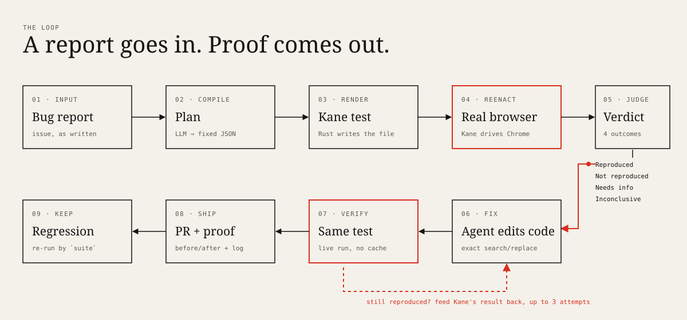
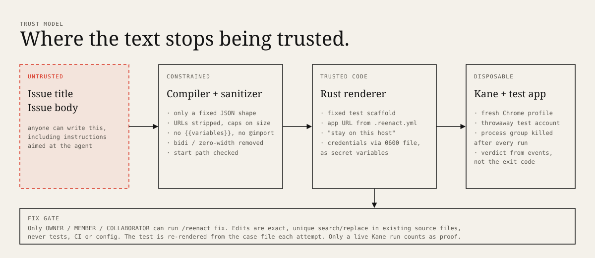

# Reenact

**Bug report in. Browser reproduction and proof out.**

Reenact reads a GitHub issue, makes a real browser do what the reporter did using [Kane CLI](https://www.testmuai.com/kane-cli/), and tells the maintainer one of four things: *Reproduced*, *Not reproduced*, *Needs info* or *Inconclusive*. The verdict comes with screenshots, Kane's own triage and the plain-English test it ran. If a maintainer comments `/reenact fix`, an agent edits the code and **the same test has to pass** before a pull request opens.

Built for the [Kane CLI Online Hackathon](https://luma.com/kanecli-online-hackathon) (12 to 19 November 2026), lane 2 ("workflows with a spine"), with Kane also used as the product's runtime (lane 3) and as the build loop for its own UI.

| | |
|---|---|
| Live case files | **https://reenact-kane.fly.dev** |
| Demo repo (real GitHub Actions runs) | [PhiBao/reenact-demo-shop](https://github.com/PhiBao/reenact-demo-shop), issues [#1](https://github.com/PhiBao/reenact-demo-shop/issues/1) [#3](https://github.com/PhiBao/reenact-demo-shop/issues/3) [#4](https://github.com/PhiBao/reenact-demo-shop/issues/4) [#5](https://github.com/PhiBao/reenact-demo-shop/issues/5), PR [#2](https://github.com/PhiBao/reenact-demo-shop/pull/2) |
| Benchmark on a real app | [`benchmark/`](benchmark/) and the [Benchmark page](https://reenact-kane.fly.dev/benchmark) |
| Demo video | _linked in the submission form_ |



## The problem

Every maintainer knows the first hour of a bug report: read a vague issue, set up the app, click around, and either find the bug or write "can't reproduce, which version?". Teams that automated this (Astro with Cloudflare, Metabase's Repro-Bot) each built a one-off tool tied to their codebase, with hand-written recipes for their app. AI has made filing issues nearly free and left reproducing them expensive.

Reenact's bet: a bug report and a Kane test are both plain English, so reproduction does not need per-app code. A report becomes a test of the *expected* behavior. If the test fails in a real browser and Kane's investigation says the app is at fault, the bug is real, and the same test becomes the acceptance test for the fix.

## Who it is for

Maintainers of web apps on GitHub, open source first, then small product teams who triage user reports. The first moment of value is the first issue comment that shows *your* bug on *your* app with the failing frame circled.

## What happens

1. **Intake.** The issue is compiled by an LLM into a fixed JSON plan: start path, steps, what *should* happen, what the reporter says happens, and what is missing. Reports that are not a browser bug, or have no steps, stop here as *Needs info* and cost no browser run.
2. **Render.** Rust (not the model) writes a Kane `_test.md` from that plan, inside a fixed scaffold. Issue text never becomes a URL, a flag or a variable name.
3. **Reenact.** `kane-cli testmd run --agent --bug-detection stop` drives Chrome. Reenact reads the NDJSON events and the sealed evidence pack, not the exit code.
4. **Judge.** *Reproduced* needs the check at the end of the reproduction step to fail **and** Kane's investigation to class it as an application defect. A failed check Kane blames on the test, or a run that got stuck, is *Needs info*, never *Reproduced*.
5. **Comment.** A strip of Kane's screenshots (the last one framed in the verdict colour, with the element that triggered the behaviour ringed), the steps taken, Kane's read on the cause, browser console and network signals, and the test itself.
6. **Fix (on `/reenact fix`).** An agent proposes exact search/replace edits. Reenact restarts the app and re-runs the same test live. Failed attempts are fed back with Kane's result, up to three. On success: a branch, a pull request, a before/after comparison and the test committed under `reenact/tests/`.
7. **Keep.** `reenact suite` re-runs every saved reproduction live. If a fixed bug returns, it exits non-zero with the evidence.

## What is new

- **The test comes from the reporter's words, not from the code or the coding agent.** Tests written by the same agent that wrote the code share its blind spots. Here the expectation is lifted from the issue before anyone looks at the diff.
- **No per-app recipes.** The tools that exist for this need code written for one codebase. Reenact takes a URL, an optional sign-in and a sentence about the app.
- **Reproduction is the acceptance test.** One artifact serves as bug proof, fix gate and regression test.
- **Honest verdicts.** Four outcomes, and *Not reproduced* explicitly does not claim the bug is absent.

## Hackathon relevance

| Judging criterion | Where it shows |
|---|---|
| **Ships** | Deployed case-file site; real GitHub Actions workflow on the demo repo; `scripts/demo.sh` runs the whole thing locally with one command. |
| **Verified** | Kane reproduced real bugs from real issues of an open-source app on its buggy release and not on its fixed release (see Benchmark, with the misses). Kane also failed this project's own UI checks once during the build, which exposed a harness bug (see "Kane in the build loop"). |
| **Closed loop** | Kane's failure evidence is the fix agent's input; the agent's output triggers a fresh Kane run of the same test; repeat until pass or give up. In CI this is `issue opened → comment → /reenact fix → PR`. |
| **Craft** | Installs by adding one workflow file and `.reenact.yml`. Every comment is a link to a case file. Product UI is a case-file ("evidence room") design, not a dashboard. |

Kane is used three ways: **runtime** (it is the thing that reproduces the bug), **gate** (it is the only judge of whether a fix worked) and **build loop** (a Kiro hook runs Kane against this repo's UI on save, `scripts/verify-ui.sh`).

## Try it

### 30 seconds, no setup

Open **https://reenact-kane.fly.dev**. Drag the before/after slider on the front page, open the case file, and read the test Kane ran. Then read the [issue thread](https://github.com/PhiBao/reenact-demo-shop/issues/1) it came from, including the comment the Action posted and [the pull request](https://github.com/PhiBao/reenact-demo-shop/pull/2) it opened.

> The demo repo's Action only auto-runs for the repo owner and collaborators, and anyone else's issue needs a maintainer to add the `reenact` label. This is deliberate: issue text is untrusted and every run costs credits.

### Run the whole thing locally

Prerequisites: Rust (stable), Node 22, Google Chrome, [Kane CLI](https://www.testmuai.com/kane-cli/) (`npm install -g @testmuai/kane-cli`, then `kane-cli login`) and an OpenAI-compatible key.

```bash
cp .env.example .env     # set REENACT_LLM_API_KEY (and base URL / model if not OpenAI)
./scripts/demo.sh        # starts the Corner Shop app, reproduces "Coupon makes my total go UP"
./scripts/demo.sh remove-wrong-item
```

It prints the verdict and writes a case folder under `.reenact/cases/`. To browse it: `cd web && pnpm install && pnpm build`, then `REENACT_CASES_DIR=.reenact/cases cargo run -p reenact-server`.

### On your own repo

`.reenact.yml` (see [`demo/shop/.reenact.yml`](demo/shop/.reenact.yml)):

```yaml
app_url: http://localhost:4100
description: One sentence about your app
# login:                       # only if the app needs a signed-in user
#   path: /auth
#   instruction: Sign in with username {{username}} and password {{password}}.
#   signed_in_check: the sign-in form is gone and the main page is shown
```

Then copy [`.github/workflows/reenact.yml`](https://github.com/PhiBao/reenact-demo-shop/blob/main/.github/workflows/reenact.yml) and set the secrets `TESTMU_USERNAME`, `TESTMU_ACCESS_KEY`, `REENACT_LLM_API_KEY`. Use a throwaway test account and a disposable instance of your app, never production.

## CLI

```text
reenact repro  --issue <url> | --title T --body-file F   reproduce a report
reenact fix    --case <dir> --repo <dir> --start-cmd ... attempt a verified fix (optionally --pr)
reenact suite  [--dir reenact/tests]                     re-run saved reproductions live
reenact ship   --case <dir> [--post --publish-branch ...] publish images, upload bundle, comment
reenact bench                                            historical benchmark on Memos
reenact verify --case <dir>                              re-run a case's test now
```

## Architecture

```text
GitHub issue ─▶ reenact (Rust CLI, runs in the repo's Action)
                 ├─ compile  LLM ─▶ Plan (fixed JSON schema) ─▶ sanitize
                 ├─ render   Plan ─▶ Kane _test.md (deterministic)
                 ├─ run      kane-cli testmd run --agent  (own process group, 0600 creds file)
                 ├─ read     NDJSON events + sealed .evidence zip (frames, triage, console, HAR)
                 ├─ judge    four verdicts
                 ├─ fix      LLM edits ─▶ restart app ─▶ same test, live
                 └─ ship     images ─▶ evidence branch · bundle ─▶ reenact-server · comment ─▶ issue
reenact-server (Axum) ─ serves case folders + web UI (Vite/React) with per-case social cards
```

| Crate / dir | Role |
|---|---|
| `crates/reenact-core` | Compiler, sanitizer, renderer, Kane runner, evidence reader, verdict, strip composer, GitHub comment. All the logic, unit tests including parsers run on real recorded Kane output and a real evidence pack. |
| `crates/reenact-cli` | The `reenact` binary: `repro`, `fix`, `suite`, `ship`, `bench`, `verify`. |
| `crates/reenact-server` | Case-file API and static UI host. A case is a folder (`case.json`, images). Uploads are bearer-token, zip-slip-safe and allow-listed. |
| `web/` | Case-file UI. Hand-written CSS, Instrument Serif + Geist, no component kit. |
| `action.yml` | Composite GitHub Action that installs Kane and Reenact and runs `repro`, `fix` or `suite`. |
| `benchmark/` | 16 historical Memos issues, with results and evidence. |
| `demo/shop` | Corner Shop, the demo target with three planted bugs. |

Why Rust for the engine: it spawns and supervises a browser agent, parses untrusted text and evidence archives, and ships as one static-ish binary that downloads in a second in CI. The case-file server is Axum with the filesystem as storage on purpose: a case is a folder you can `ls`.



## Verification: what is real

| Claim | Status |
|---|---|
| Reproduction of real issues in a real browser | **Real.** Kane CLI 0.10.3 driving Chrome. Benchmark runs are in `benchmark/`. |
| Historical benchmark | **Real** Memos releases from Docker, issues written by real users. Reenact's plan is compiled once and run on both releases. |
| GitHub Action, comment, PR | **Real.** See the demo repo runs. |
| Fix loop | **Real** against the Corner Shop demo. **Its three bugs are planted by us** to have something fixable end to end; the benchmark is the evidence on real apps. |
| Fix loop on real apps | **Not shown.** Memos is Go and React and needs a build we did not wire in. |
| Case-file site | **Real**, deployed on Fly.io. |
| Cached replay as a regression check | **Not used, and why:** see the next section. |
| Mocked / simulated | Nothing in the product path. `web/fixtures/` holds a copy of one real case for the UI tests. |

## Benchmark

Sixteen closed [Memos](https://github.com/usememos/memos) issues (12 bugs, 4 controls that are not bugs), each tied to the release that had the problem and the release that fixed it, run from pinned Docker images. Reenact compiles each report **once**, then runs the same plan against both releases. A correct result is *Reproduced* on the buggy release and *Not reproduced* on the fixed one; controls must be *Not reproduced* on both. Case list and notes: [`benchmark/cases.json`](benchmark/cases.json), [`benchmark/TARGET.md`](benchmark/TARGET.md). Per-run verdicts, Kane's reasons and the evidence strips are in [`benchmark/round1/`](benchmark/round1/) and [`benchmark/runs/`](benchmark/runs/) (`RESULTS.md`, `results.json`, one folder per run).

| | Round 1 | Round 2 |
|---|---|---|
| Both releases judged correctly (of 16) | 7 | **8** |
| Bugs reproduced on the buggy release (of 12) | 5 | **8** |
| Bugs cleared on the fixed release (of 12) | 11 | 9 |
| Bug reports wrongly *Reproduced* on the fixed release | 1 | **0** |
| *Reproduced* verdicts on the 4 controls (8 runs) | 1 | 4 |

Round 2 ran after two changes found in round 1: preconditions are no longer rendered into the test, and the scaffold tells Kane not to undo or work around unexpected behavior. Both are general, not per-case, but they were made after seeing round-1 results, so treat round 2 as tuned and expect lower numbers on unseen apps.

What the numbers say:

- **It finds bugs more often than it misses them, and it rarely accuses a fixed release.** No fixed release of a real bug was called *Reproduced* in round 2. When it says *Reproduced*, Kane's own investigation agreed it was an application defect.
- **It is not a lie detector for "working as intended".** Two controls (HTML collapsing repeated spaces, and a checkbox report whose real bug is a different one) were *Reproduced* on both releases. Reenact observes behavior; it cannot know a maintainer's intent. This is why the comment states the expected behavior it tested and why a human decides.
- **Run-to-run variance is real.** `tag-with-ampersand` was reproduced in round 1 and not in round 2, with the same report. Kane is an agent, and Reenact retries once on inconclusive results but does not hide the variance.
- **Misses cluster in visual and rendering bugs** (currency text rendered as math, `tel:` link targets) where a screenshot check cannot see the difference, and in cases where Kane could not finish the steps (*Needs info*).
- Several benchmark reports are deliberately noisy: a typo in the repro steps, a wrong version, a screenshot-only report. They are kept because real reports look like that.
- Cost: about 35 Kane credits and 2 to 3 minutes per run.

Reproduce a round: `reenact bench --parallel 3` (needs Docker, Kane CLI and an LLM key; pulls the Memos images).


## What building on Kane taught us

These are the findings that changed the design. They are useful to anyone wiring Kane into an agent.

1. **Cached replays cannot catch regressions.** After Kane authors a passing test, `testmd run` replays the recording without the model. We ran the saved test against the *buggy* app and it still **passed**: replayed checks reuse the values recorded at authoring time (the run context showed the cached `$10.00` when the page said `$30.00`). So `reenact suite` and every verification run with `--author`, a live agent run each time. It costs credits (about 20 to 30 per test) and is the only way to get a real answer.
2. **Trust the events, not the exit code.** We take the verdict from `run_end`, `reason_code` and `test_md_bug_verdict`. `--bug-detection stop` is what produces a *confirmed product bug* classification; without it a failed assertion reads as a test problem.
3. **Preconditions become checkpoints.** Writing "make sure a memo exists" into a test makes Kane check it *before* the steps that create it, and fail. Reenact never renders preconditions.
4. **Kane repairs what it was asked to observe.** On the "Remove deletes the wrong item" report, Kane noticed the wrong item vanish, restored it, removed the right one and passed. The scaffold now says: do each step once, do not undo or work around anything unexpected, check right after the last step.
5. **Process groups.** Killing the `kane-cli` child leaves Chrome running. Each run leads its own group and is killed as a group, as GuardianKane's author also found.

## Kane in the build loop

`scripts/verify-ui.sh` builds the web UI, serves fixture cases, and has Kane check two pages in plain English (`tests/ui/*_test.md`), live with `--author` because cached replays would not notice a change (our own finding above; the first version of the script made that mistake and reported `replay completed`). A Kiro hook (`.kiro/hooks/kane-verify-ui.json`) runs it when a file under `web/src/` is saved. Kane failed this suite once during the build: a stale server from an earlier run was answering on the test port with the wrong data, so the Benchmark page showed its error state and Kane reported the table missing. The script now refuses to run if the port is busy.

## Security and reliability

- **Issue text is hostile input.** It is clipped, stripped of control and bidi characters, URLs and Kane's template syntax (`{{ }}`, `@import`), and the model may only return a fixed JSON shape. The start URL is `app_url + a checked path`; the model never supplies one. See `crates/reenact-core/src/sanitize.rs` (unit-tested against injected payloads).
- **Prompt injection is bounded, not solved.** A hostile report could still try to steer the browser agent. The blast radius is a throwaway test account on a disposable instance, a "stay on this host" instruction and a fresh browser profile. Do not point Reenact at production data.
- **Who can spend money or change code.** Auto-run is limited to repo owners, members and collaborators; anyone else's issue needs a maintainer's `reenact` label. `/reenact fix` is honored only from people with write access, and never on pull requests.
- **The fix agent cannot grade itself.** Edits must be exact, unique search/replace in existing source files; tests, CI, config and `reenact/` are off limits; the test is re-rendered from the case file each attempt; only a live Kane run counts.
- **Secrets.** Test credentials reach Kane through a `0600` variables file as secret variables, never argv. GitHub tokens reach `git` through environment config, not the command line. Kane evidence packs are sealed unredacted, so treat them as sensitive. They are not published; only screenshots, the case JSON and Kane's share link are.
- **Server.** Uploads need a bearer token (constant-time compare), reject paths outside the case folder, accept only `case.json` and images, and cap sizes. The Fly volume holds only case folders.
- **Failure states.** Kane error, timeout and credit exhaustion produce *Inconclusive* and say nothing about the bug. One automatic retry for *Needs info* and *Inconclusive*. A fix that fails three times is reported with what was tried.

## Limitations

- Visual or subtle rendering bugs (the currency formatting and nested-list level cases) are hard for a vision-based check and are the main source of misses. Stateful and functional bugs work best.
- A report that depends on data, settings or versions the fresh test instance does not have will not reproduce. *Not reproduced* means "not on this version with this data", and the comment says so.
- Plans are compiled by an LLM, so two runs of the same issue can differ. The benchmark compiles once per case and runs both releases with the same plan to keep the comparison fair.
- Kane runs cost credits (about 20 to 60 per run here) and take 1 to 4 minutes.
- Web desktop only. Kane supports mobile; Reenact does not use it yet.
- Single-tenant. The case-file server has one upload token.

## Roadmap

Version bisect across releases ("reproduces in 0.24, fixed in 0.26"), a backlog sweep that triages every open issue read-only, mobile targets through Kane, a fix target on a real app, support tickets from Intercom and Zendesk as report sources, and a hosted GitHub App.

## Develop

```bash
cargo test --workspace && cargo clippy --workspace -- -D warnings
(cd web && pnpm install && pnpm build)
./scripts/verify-ui.sh        # Kane checks the UI in a real browser
```

Environment: `REENACT_LLM_API_KEY`, `REENACT_LLM_BASE_URL`, `REENACT_LLM_MODEL`, `REENACT_FIX_MODEL` (optional), `REENACT_USERNAME` / `REENACT_PASSWORD` (test account), `KANE_CLI_BIN`. Server: `PORT`, `REENACT_CASES_DIR`, `REENACT_WEB_DIR`, `REENACT_BENCHMARK_FILE`, `REENACT_UPLOAD_TOKEN`, `REENACT_PUBLIC_URL`.

## Credits

Built with Kiro and Kane CLI by TestMu AI. Licensed under Apache-2.0. Memos is a project of the Memos authors and is used here only as a test subject.
